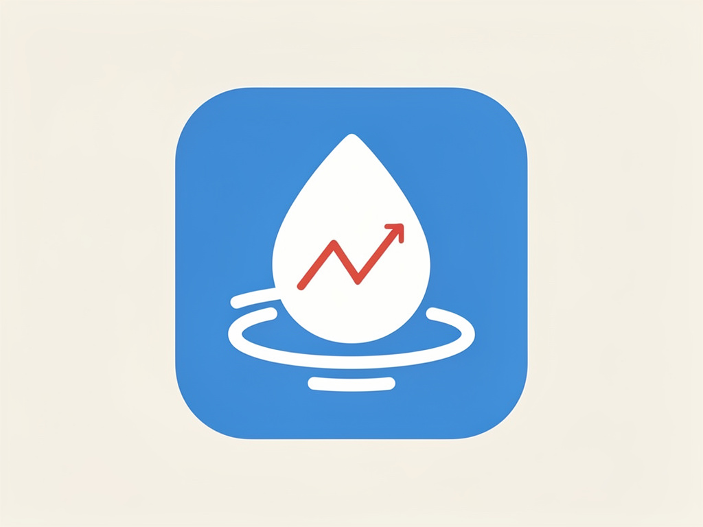

# Virtual Flush Meter

[🇬🇧 English version](README.md)



Intégration [Home Assistant](https://www.home-assistant.io/) qui **compte les chasses d'eau** et estime l'**eau chassée (en litres)** à partir d'une seule sonde de température plongée dans la cuvette des WC (ex. Sonoff SNZB-02D). L'entité litres peut être ajoutée dans la section **Eau** du tableau de bord Énergie comme appareil d'eau individuel.

> 🚧 En cours de développement : la configuration est disponible, la détection des chasses n'est pas encore implémentée.

## Principe

Après une chasse, la cuvette se remplit d'eau fraîche du réseau, dont la température diffère de l'eau qui stagnait. La sonde voit une variation nette (à la hausse ou à la baisse), détectée comme une chasse :

- variation cumulée ≥ 1,0 °C en 30 min maximum,
- vitesse de variation ≥ 0,3 °C/min,
- au moins 5 min entre deux chasses.

```
Litres = chasses × volume par chasse × calibration
```

En bonus, le minimum glissant de la sonde sur plusieurs heures donne une approximation de la **température de l'eau froide du réseau**.

## Configuration

| Champ | Défaut |
|---|---|
| Sonde de température dans la cuvette | obligatoire |
| Vitesse de variation minimale (°C/min) | 0,3 |
| Variation de température minimale (°C) | 1,0 |
| Fenêtre de détection (min) | 30 |
| Délai minimal entre deux chasses (min) | 5 |
| Volume par chasse (L) | 6 |
| Facteur de calibration | 1 |
| Fenêtre du minimum glissant eau froide (h) | 12 |

Tous les champs sauf la sonde sont modifiables ensuite via **Configurer** sur la carte de l'intégration.

## Limites connues

- Chasses manquées quand l'eau du réseau et l'eau de la cuvette sont à peu près à la même température (intersaison).
- La sonde ne remonte que les variations d'au moins 0,1 °C : la partie la plus rapide de la variation est mal mesurée.
- Distinguer les chasses de 3 L et de 6 L est expérimental.

## Installation

Via [HACS](https://hacs.xyz/) → Dépôts personnalisés → `https://github.com/rambobinator/ha-virtual-flush-meter` (catégorie : Intégration), puis redémarrer Home Assistant et ajouter **Virtual Flush Meter** depuis Paramètres → Appareils et services.

## Licence

MIT
